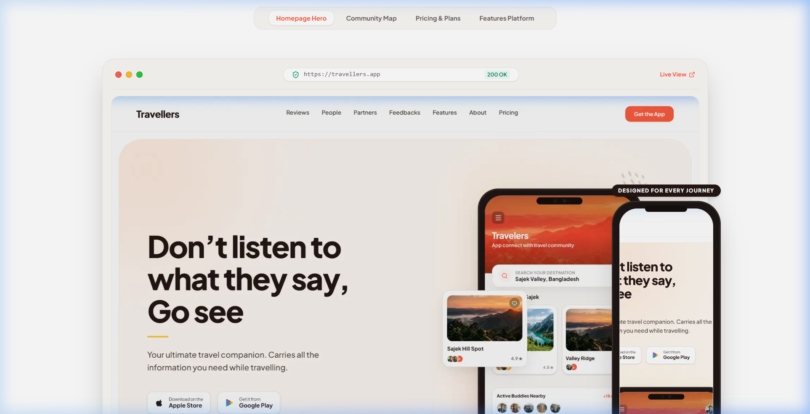
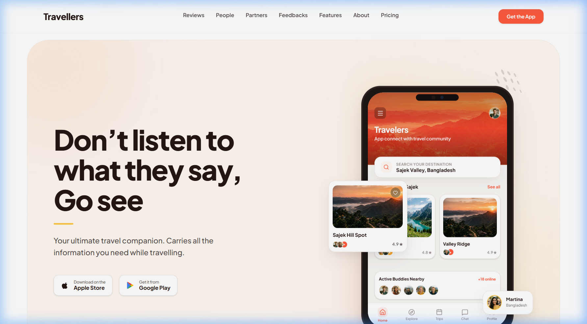
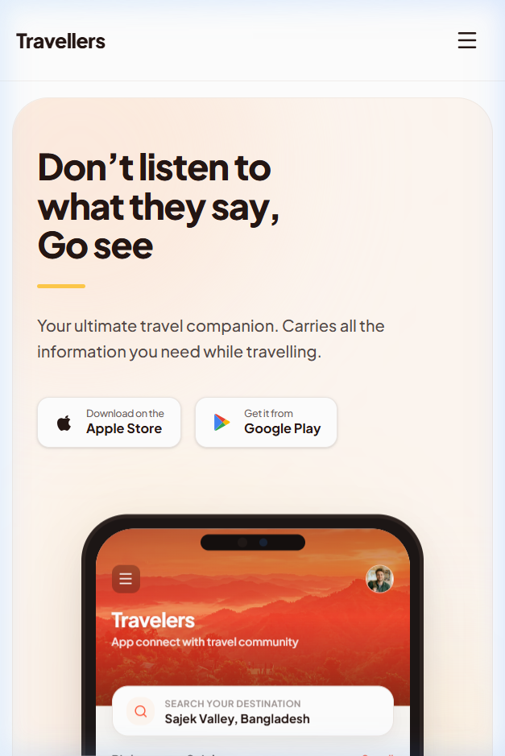
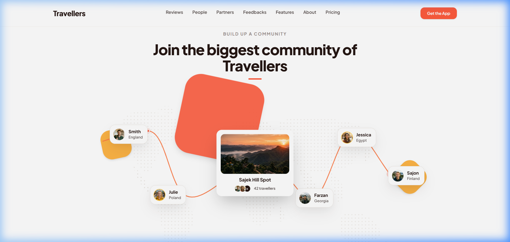
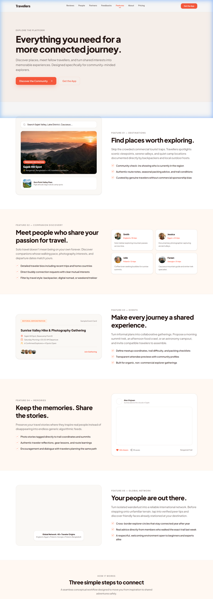

# Travellers — Travel Community Multi-Page Website

> *"Don't listen to what they say, Go see."*



A modern, editorial, community-driven travel platform website built to connect adventurous solo travelers, backpackers, and digital nomads worldwide. Developed as a multi-page web application using Next.js 16 App Router, TypeScript, and Tailwind CSS 4 with pixel-level fidelity to the brand design system.

[](https://nextjs.org/)
[](https://react.dev/)
[](https://www.typescriptlang.org/)
[](https://tailwindcss.com/)
[](#)

---

## 🎨 Visual Showcase & Previews

The project includes a dedicated **Website Showcase Mockup** page (`/showcase`) designed to present the platform as an editorial digital product portfolio:

| Desktop Browser Preview (1440 × 900) | Mobile Smartphone Preview (390 × 844) |
| :---: | :---: |
|  |  |

| Community Route Map Preview | Platform Features Preview |
| :---: | :---: |
|  |  |

---

## 🌟 Pages & Architecture

1. **Website Showcase Mockup (`/showcase`):**
   - Studio presentation displaying realistic desktop browser and smartphone hardware frames.
   - Interactive screen tab switcher (Homepage, Community Map, Pricing, Features).
   - Core feature pillars: Global Community, Memories, Curated Travelers, Membership Tiers.
   - Responsive design audit (Mobile vs Desktop viewport comparison).
   - Design System snapshot with copy-to-clipboard color tokens and typography scale.
   - Project specifications and open-source tech stack audit.

2. **Home Landing Page (`/`):**
   - High-contrast editorial hero with app store download badges and phone mockup.
   - Interactive Community world map with 6 waypoint traveler nodes and continuous Bezier curve.
   - Experience & Feedbacks section (`#experience`, `#feedbacks`) with Luke James testimonial.
   - Popular Travellers section (`#popular`) with avatar buddy stack and interactive phone inspection.
   - Interactive Pricing Table (`#pricing`) with monthly/annual spring slider toggle.
   - Vibrant coral-orange Download CTA banner (`#download`).
   - 5-column sitemap footer with factual community beta indicators and demo newsletter form.

3. **About Us (`/about`):**
   - Editorial hero: *"Travel is better when shared."*
   - Brand Story: *"More than destinations. It's about connections."*
   - Mission & Vision: *"Make every journey more connected"* and *"A world where travellers never have to explore alone."*
   - 4 Core Principles: Connection, Exploration, Authenticity, Community.
   - Transparent Platform Operations trust notice.
   - Closing dual-action CTA.

4. **Platform Features (`/features`):**
   - Hero: *"Everything you need for a more connected journey."*
   - 5 Detailed Feature Showcases:
     1. Discover Destinations (visual card with check-ins and trail tags)
     2. Meet Fellow Travellers (traveler cards with bios and country badges)
     3. Create & Join Events (demonstration event board with attendee avatars)
     4. Share Memories (two-photo split story collage with cheers/saves)
     5. Build Your Travel Community (world map network with floating traveler waypoints)
   - 3-Step Conceptual Workflow (Discover, Connect, Explore Together).
   - Closing CTA.

5. **Privacy Policy (`/privacy`) — Draft for Review:**
   - Reusable `LegalLayout` with sticky Table of Contents.
   - 12 comprehensive sections based on factual engineering audit (0 tracking cookies verified).
   - Clear distinction between active prototype capabilities and planned backend databases.

6. **Terms of Service (`/terms`) — Draft for Review:**
   - Reusable `LegalLayout` with sticky Table of Contents.
   - 15 comprehensive legal sections including critical outdoor activity disclaimer.
   - Community safety standards and intellectual property protections.

---

## 🛠️ Technology Stack

- **Framework:** Next.js 16.4 (App Router with Turbopack, React 19)
- **Language:** TypeScript 5
- **Styling:** Tailwind CSS 4 with CSS Custom Properties token design system
- **Motion & Animation:** Framer Motion (`motion/react`)
- **Typography:** Plus Jakarta Sans via `next/font/google`
- **Icons:** Lucide React & Custom SVG Brand Vectors
- **Testing & QA:** Automated browser subagent visual verification, ESLint, Next.js Turbopack production build

---

## 📁 Project Structure

```text
traveller/
├── public/
│   └── assets/
│       ├── brand/           # Travellers wordmark vector
│       ├── travelers/       # High-res photo of traveler with orange backpack
│       ├── destinations/    # Sajek Hill sunset & lake valley photography
│       ├── avatars/         # Diverse traveler profile portraits
│       └── illustrations/   # Dotted world map, blobs, city sketch, speckles
├── src/
│   ├── app/
│   │   ├── about/           # About Us page (/about)
│   │   ├── features/        # Platform Features page (/features)
│   │   ├── privacy/         # Privacy Policy page (/privacy)
│   │   ├── terms/           # Terms of Service page (/terms)
│   │   ├── globals.css      # Design tokens, variables, shadows, watermark
│   │   ├── layout.tsx       # Root layout, Plus Jakarta Sans, SEO metadata
│   │   └── page.tsx         # Main landing page with all 8 sections & modals
│   ├── components/
│   │   ├── layout/          # Navbar, Footer, LegalLayout
│   │   ├── sections/        # Hero, Community, Experience, Popular, Pricing, CTA
│   │   └── ui/              # Button, StoreButton, SectionEyebrow, Modal, PhoneMockups
│   └── data/
│       └── travelData.ts    # Single source of truth for navigation, travelers, features
├── docs/
│   ├── PROJECT_OVERVIEW.md       # Product vision, brand identity, and multi-page scope
│   ├── DESIGN_SYSTEM.md          # Color tokens, typography matrix, shadows, radii
│   ├── ROUTES_AND_NAVIGATION.md  # Route map, root-relative anchors, deferred links policy
│   ├── CONTENT_INVENTORY.md      # Page content and asset mapping
│   ├── LEGAL_REVIEW_CHECKLIST.md # Legal confirmations and open decision checklist
│   └── TESTING_REPORT.md         # QA execution matrix, responsiveness & build audit
├── AGENTS.md                     # Project operational guidelines
└── README.md
```

---

## 🚀 Getting Started

### 1. Prerequisites
- Node.js `v20+` or `v22+`
- npm `v10+`

### 2. Installation
```bash
git clone https://github.com/dmsda/traveller.git
cd traveller
npm install
```

### 3. Running Locally
```bash
npm run dev
```
Open [http://localhost:3000](http://localhost:3000) in your browser.

### 4. Build, Lint & Type-Check
```bash
# Code style and lint check (0 errors, 0 warnings)
npm run lint

# TypeScript strict type checking
npm run typecheck

# Production compilation with Next.js Turbopack
npm run build
```

---

## 🤝 Community & Contributing

We welcome community members and developers to contribute! Please review our open-source documentation:
- 📖 [Contributing Guidelines](CONTRIBUTING.md) — Prerequisites, branching convention, and PR quality gates.
- 🛡️ [Security Policy](SECURITY.md) — Responsible vulnerability reporting and security posture.
- 📜 [Code of Conduct](CODE_OF_CONDUCT.md) — Community pledge and standards of interaction.
- 📝 [Changelog](CHANGELOG.md) — Version history and release notes.

---

## 📸 Updating Showcase Screenshots

The showcase images located in `public/showcase/` represent real viewport captures of the running web application:

| File Name | Purpose | Target Dimensions |
| :--- | :--- | :--- |
| `main-showcase-preview.png` | GitHub README Header & Hero Showcase | 1600 × 900 px (16:9) |
| `desktop-preview.png` | Desktop Browser Mockup Frame | 1440 × 900 px (16:10) |
| `mobile-preview.png` | Handheld Smartphone Mockup Frame | 390 × 844 px (iPhone view) |
| `community-preview.png` | Community Map & Route Waypoints | 1440 × 750 px |
| `pricing-preview.png` | Membership Cards & Billing Toggle | 1440 × 750 px |
| `features-preview.png` | Platform Feature Modules Breakdown | Full page capture |

To refresh or update these screenshots:
1. Start the local development server: `npm run dev`
2. Open the page in your browser or browser automation suite at the specified viewports.
3. Save the captured `.png` files into `public/showcase/` with the exact file names above.
4. Next.js will automatically pick up and serve the refreshed assets on `/showcase` and in the README.

---

## ⚙️ Repository Configuration

The repository URL is configured for:
```
https://github.com/dmsda/traveller.git
```
To adjust repository references across the showcase header and footer, update `GITHUB_REPO_URL` in [`src/components/showcase/ShowcaseNavbar.tsx`](src/components/showcase/ShowcaseNavbar.tsx).

---

## 📄 License

This open-source project is prepared for distribution under the **MIT License** (awaiting final license selection by repository owner [@dmsda](https://github.com/dmsda)).

---

## 🙏 Acknowledgments & Attributions

- **Typography:** [Plus Jakarta Sans](https://fonts.google.com/specimen/Plus+Jakarta+Sans) by Tokotype via `next/font/google`.
- **Icons:** [Lucide Icons](https://lucide.dev/) and custom vector brand wordmarks.
- **Imagery:** Scenic travel photography and portrait assets crafted exclusively for the Travellers prototype demonstration.
- **Framework:** [Next.js](https://nextjs.org/) by Vercel and [Tailwind CSS](https://tailwindcss.com/).


